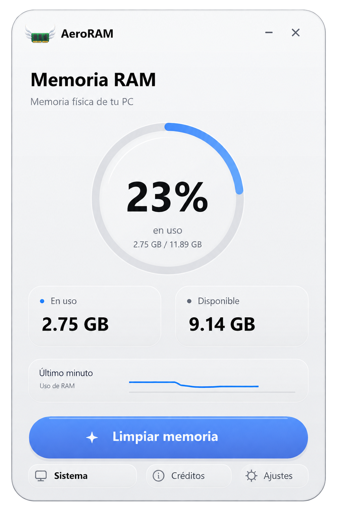

# AeroRAM

Monitor de memoria RAM para Windows con limpieza manual, información del sistema y una interfaz de estilo glassmorphism.

**Desarrollador:** Cristian Skylar  
**Versión:** 0.5.0

  

## Cómo abrir AeroRAM

1. Descarga el archivo ZIP de AeroRAM.
2. Descomprímelo en una carpeta de tu PC.
3. Dentro de esa carpeta, abre **AeroRAM.exe**.
4. Cuando Windows solicite permiso de administrador, pulsa **Sí** para abrirlo.

AeroRAM es portátil y no necesita instalación.

## Funciones

- Consulta de RAM usada, disponible y total, con historial de uso.
- Limpieza manual de memoria y visualización del resultado.
- Panel **Sistema** con fabricante, modelo, CPU, módulos de RAM, gráficos, discos, red, audio y dispositivos.
- Copia del informe del equipo, actualización de datos y acceso a **dxdiag**.
- Temas claro y oscuro, animaciones y minimización junto al reloj.
- Interfaz en español, inglés, portugués y francés, con selección desde Ajustes.

## Cambios importantes

- **0.5.0:** selector de cuatro idiomas con cambio inmediato, preferencia guardada y traducción de mensajes e informes.
- **0.4.3:** fondo opaco en ambos temas, conservando los reflejos y el acabado de vidrio.
- **0.4.1:** corrección del recorte de las cuatro esquinas y del cambio de escala de pantalla.
- **0.4:** apartado **Créditos** con autoría, versión y enlaces a redes sociales.
- **0.3:** nuevo nombre y logo de AeroRAM, y panel de especificaciones del sistema.

## Uso

Pulsa **Limpiar memoria** para ejecutar una limpieza. El resultado aparece sobre el botón y permite abrir sus detalles. El cambio de RAM disponible puede variar; una limpieza no garantiza más velocidad.

Abre **Sistema** para consultar el equipo. Usa las pestañas para cambiar de apartado y la rueda del ratón para desplazarte. **Copiar informe** guarda los datos en el portapapeles; **Actualizar** vuelve a consultarlos. Si Windows no proporciona un dato, se muestra **No reportado**.

En **Ajustes** puedes cambiar el tema, las animaciones, el idioma y las opciones de limpieza. El idioma elegido se conserva al volver a abrir AeroRAM. Si está activa la opción de minimizar al cerrar, AeroRAM permanece junto al reloj. Para salir por completo, haz clic derecho en su icono y selecciona **Salir**.

## Requisitos

- PC con Windows de 64 bits y arquitectura x64.
- Permiso de administrador para ejecutar la limpieza.
- Desarrollo orientado a Windows 10; Windows 11 está pendiente de validación completa.

## Cristian Skylar

- [Sitio Oficial de Cristian Skylar](https://cristianskylar.com)
- [Instagram](https://www.instagram.com/CristianSkylarr/)
- [X](https://x.com/CristianSkylarr)
- [LinkedIn](https://www.linkedin.com/in/cristianskylar/)

## Licencia

Se permite usar y redistribuir copias originales de AeroRAM sin cambios. Las modificaciones requieren autorización escrita de Cristian Skylar. Consulta [LICENSE](LICENSE). Los componentes de terceros conservan sus propias licencias, descritas en [THIRD-PARTY.txt](THIRD-PARTY.txt).
